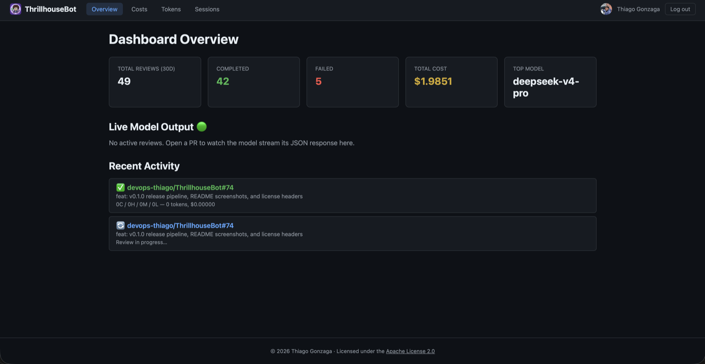

> **"Everything's coming up Thrillhouse!"**

A self-hosted, GraalVM-native PR review bot, built as a GitHub App with Quarkus.
It reviews pull requests using any OpenAI-compatible chat API, so the review is
language-agnostic and you can pick the provider that suits you — including a
local Ollama model, so no code has to leave your network.

## Features

- Reviews diffs for correctness, security, regressions, stale comments and code quality, and tags every finding `critical`, `high`, `medium` or `low`
- Reviews large pull requests whole: the diff is split into token-budgeted batches reviewed in parallel, and any file that does not fit is named
- Inline suggestions you can apply with one click
- A second pass re-checks each finding against the diff before it is posted
- Follow-up reviews track whether earlier findings were fixed, declined or are still open, and re-check a maintainer's decline against the code
- One summary comment per pull request, edited in place every round, with a risk breakdown, a changed-files walkthrough and every finding still open
- Comment commands (`/review`, `/summary`, `/describe`, `/changelog`, `/add-docs`, `/improve`, `/generate-tests`, `/resolve`, `/pause`, `/resume`, `/help`, and with learnings on `/learnings`, `/remember`, `/forget`) and conversational replies to `@thrillhousebot`
- Auto-review triggers: skip drafts, gate on labels, filter by base branch, and optionally space out reviews of one PR (`AUTO_REVIEW_MIN_INTERVAL`)
- Maintainer 👍/👎 reactions and "not useful" replies are recorded as [finding feedback](https://devops-thiago.github.io/ThrillhouseBot/feedback/)
- Optional review context, each off by default: the issues a PR links and their acceptance criteria, the CI checks that already failed on the head commit, patch coverage from your own coverage report, and review learnings (maintainer declines and `/remember` conventions from earlier reviews of the same repository)
- Optional deterministic scan of added lines for leaked credentials and risky Terraform, Kubernetes, CloudFormation and Dockerfile settings, with no model call and every matched secret redacted
- Optional per-call review dimension routing, which sends each call only the review rules its files need
- Optional outgoing notification when a review completes or fails: JSON, Slack or Discord, HMAC-signed, metadata only unless you opt in
- Per-repository instructions in `.github/thrillhousebot.md` (falling back to Copilot, Claude and Agents files) and per-repository ignore globs and path-scoped rules in `.github/thrillhousebot.yml`
- Optional reasoning-effort setting and per-model generation and budget caps
- Live dashboard (Next.js) with a WebSocket activity feed, cost charts and token tracking
- OpenTelemetry traces, token histograms, cost counters and latency metrics

## Where to go next

- **[Getting started](/ThrillhouseBot/getting-started/)** — create the GitHub
  App with the [hosted installer](/ThrillhouseBot/install.html) and run the bot
  with Docker Compose.
- **[Commands](/ThrillhouseBot/commands/)** — drive the bot from a PR:
  `/review`, `/describe`, `/changelog`, `/add-docs`, `/improve`,
  `/generate-tests`, and more.
- **[Configuration](/ThrillhouseBot/configuration/)** — every environment
  variable, with defaults.
- **[AI providers](/ThrillhouseBot/providers/)** — point the bot at the
  OpenAI-compatible endpoint of your choice.
- **[Architecture](/ThrillhouseBot/architecture/)** — how a review flows
  through the system.
- **[Finding feedback](/ThrillhouseBot/feedback/)** — maintainer 👍/👎 capture,
  and how it differs from review learnings.
- **[How it compares](/ThrillhouseBot/comparison/)** — an honest look at where
  ThrillhouseBot sits next to other AI code-review tools.
- **[Contributing](/ThrillhouseBot/contributing/)** — development setup and the
  CI bar.

## Dashboard

The built-in dashboard (Next.js, served by the bot itself) shows summary cards,
a live activity feed that streams the model's output as a review runs, cost
charts by model, token breakdowns, and a paginated session history:

## Community and license

Questions and setup help belong in
[GitHub Discussions](https://github.com/devops-thiago/ThrillhouseBot/discussions);
bugs and feature requests in
[Issues](https://github.com/devops-thiago/ThrillhouseBot/issues/new/choose).

Licensed under the
[Apache License 2.0](https://github.com/devops-thiago/ThrillhouseBot/blob/main/LICENSE)
(SPDX: `Apache-2.0`).
