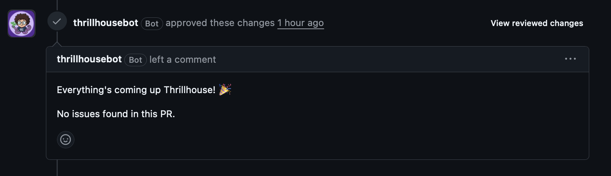

> **"Everything's coming up Thrillhouse!"**

ThrillhouseBot is a self-hosted GitHub App built with Quarkus and distributed
as a GraalVM native binary. It sends pull-request diffs to the
OpenAI-compatible chat API you configure. A local Ollama endpoint keeps model
requests on your network; language support depends on the model.

## Features

<!-- include: ../../../../README.md#features -->

## Where to go next

- **[Getting started](/ThrillhouseBot/getting-started/)** — create the GitHub
  App with the [hosted installer](/ThrillhouseBot/install.html) and run the bot
  with Docker Compose.
- **[Commands](/ThrillhouseBot/commands/)** — drive the bot from a PR:
  `/review`, `/describe`, `/changelog`, `/add-docs`, `/improve`,
  `/generate-tests`, and more.
- **[Configuration](/ThrillhouseBot/configuration/)** — every environment
  variable, with defaults.
- **[AI providers](/ThrillhouseBot/providers/)** — point the bot at the
  OpenAI-compatible endpoint of your choice.
- **[Architecture](/ThrillhouseBot/architecture/)** — how a review flows
  through the system.
- **[Finding feedback](/ThrillhouseBot/feedback/)** — maintainer 👍/👎 capture,
  and how it differs from review learnings.
- **[How it compares](/ThrillhouseBot/comparison/)** — deployment, model support,
  review context and costs across code-review tools.
- **[Contributing](/ThrillhouseBot/contributing/)** — development setup and the
  CI bar.

## Dashboard

The built-in dashboard (Next.js, served by the bot itself) shows summary cards,
a live activity feed that streams the model's output as a review runs, cost
charts by model, token breakdowns, and a paginated session history. Its Live
page follows one review step by step, with the tokens and cost spent so far and,
when enabled, the model's reasoning:

## Community and license

Questions and setup help belong in
[GitHub Discussions](https://github.com/devops-thiago/ThrillhouseBot/discussions);
bugs and feature requests in
[Issues](https://github.com/devops-thiago/ThrillhouseBot/issues/new/choose).

Licensed under the
[Apache License 2.0](https://github.com/devops-thiago/ThrillhouseBot/blob/main/LICENSE)
(SPDX: `Apache-2.0`).
